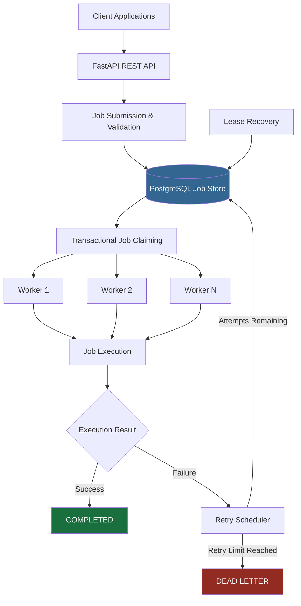
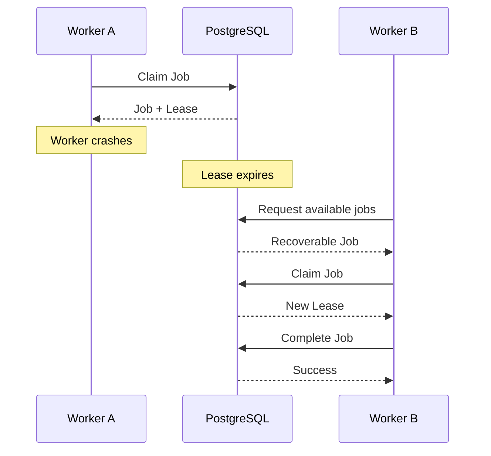
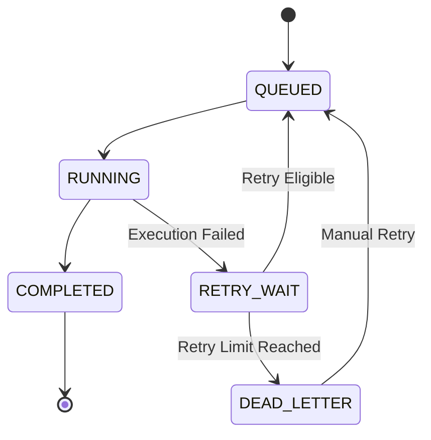

<div align="center">

# ⚡ QueueForge

### Distributed Job Processing Engine

**Reliable. Fault-Tolerant. Concurrent.**

A PostgreSQL-backed distributed job queue engineered to handle asynchronous workloads through concurrent workers, lease-based recovery, intelligent retries and fault-tolerant execution.

<br/>


<br/>

[Explore Architecture](#-system-architecture) •
[Core Features](#-engineering-capabilities) •
[Quick Start](#-quick-start) •
[Testing](#-testing--reliability)

<br/>

**Built by Heshma Sree Avuthu**

</div>

---

## 🧩 The Problem

Modern applications depend on background operations such as data processing, notifications, report generation and scheduled tasks.

Running these operations directly inside HTTP request handlers introduces several problems:

- ⏳ Increased API response times.
- 💥 Lost jobs when application processes crash.
- 🔄 Duplicate execution during request retries.
- ⚠️ Unreliable handling of temporary failures.
- 📈 Difficulty scaling background processing independently.

### The Solution: QueueForge

QueueForge separates job submission from job execution.

It provides a persistent job-processing infrastructure where API requests create jobs, PostgreSQL coordinates multiple workers, and a fault-recovery mechanism handles abandoned or unsuccessful executions.

**The engineering objective:** Build a reliable job-processing system without depending on an external message broker.

---

## ✨ Engineering Capabilities

<table>
<tr>
<td width="50%">

### ⚡ Concurrent Processing
Multiple workers claim and execute independent jobs using PostgreSQL transactional row locking.

</td>
<td width="50%">

### 🛡️ Fault Recovery
Lease-based ownership and expiration detection recover jobs abandoned by crashed workers.

</td>
</tr>
<tr>
<td width="50%">

### 🔁 Intelligent Retries
Exponential backoff with jitter prevents aggressive, synchronized retry attempts.

</td>
<td width="50%">

### 🔐 Idempotent Submission
Idempotency keys prevent duplicate job creation when clients repeat requests.

</td>
</tr>
<tr>
<td width="50%">

### 🎯 Priority Scheduling
Jobs are selected according to scheduling priority and execution eligibility.

</td>
<td width="50%">

### ☠️ Dead-Letter Queue
Jobs exceeding their retry limits are isolated for investigation and manual recovery.

</td>
</tr>
<tr>
<td width="50%">

### ⏰ Delayed Execution
Schedule jobs for execution at a future time instead of processing them immediately.

</td>
<td width="50%">

### 📊 Operational Visibility
Monitor job states, execution outcomes, retries and queue statistics.

</td>
</tr>
</table>

---

## 🏗️ System Architecture

QueueForge follows a decoupled producer-consumer architecture with PostgreSQL acting as the persistent coordination layer.



### Component Responsibilities

| Component | Responsibility |
|:---|:---|
| FastAPI | Job submission and management |
| PostgreSQL | Persistent storage and worker coordination |
| Worker Pool | Independent background execution |
| Lease Manager | Detects abandoned jobs and enables recovery |
| Retry Scheduler | Handles retry timing and backoff |
| Idempotency Layer | Prevents duplicate job submissions |
| Dead-Letter Queue | Isolates permanently failed jobs |

---

## ⚙️ Engineering Capabilities

### 01. Concurrent Job Claiming

The system uses PostgreSQL's:

```sql
SELECT ... FOR UPDATE SKIP LOCKED;
```

This allows multiple workers to claim different available jobs without unnecessarily blocking one another.

**Why it matters:**

- Reduces worker contention.
- Prevents simultaneous claims of the same queued job.
- Enables concurrent processing.
- Uses database-level transactional guarantees.

### 02. Lease-Based Recovery

Every claimed job receives a time-limited execution lease.



Lease expiration allows abandoned jobs to become eligible for recovery.

Worker ownership checks help prevent stale workers from overwriting newer execution results.

### 03. Exponential Backoff with Jitter

Repeated failures should not cause workers to retry continuously.

QueueForge implements exponential retry scheduling.

```python
delay = min(
    base_delay * (2 ** (attempt - 1)),
    maximum_delay
)
```

Jitter is added to reduce synchronized retry traffic.

### 04. Idempotency

Network failures can leave clients uncertain about whether a job was successfully submitted.

Idempotency keys help ensure that repeating the same submission does not create another job.

### 05. Dead-Letter Handling

When a job exhausts its configured retry attempts, it transitions into a dead-letter state.

This separates permanently unsuccessful jobs from normal processing and allows investigation or manual retry.

---

## 🔄 Job Lifecycle



**Delivery Guarantee: At-Least-Once**

QueueForge prioritizes reliable processing and job recovery.

A job may execute more than once under certain failure conditions. Consequently, job handlers should be designed to be idempotent.

---

## 🧰 Technology Stack

| Layer | Technology |
|:---|:---|
| Programming Language | Python |
| API Framework | FastAPI |
| Persistent Storage | PostgreSQL |
| Concurrency Control | SQL Transactions, Row-Level Locking |
| Processing Architecture | Producer-Consumer |
| Retry Strategy | Exponential Backoff + Jitter |
| Testing | Pytest |
| Containerization | Docker |
| Orchestration | Docker Compose |
| CI/CD | GitHub Actions |

---

## 🚀 Quick Start

Get QueueForge running locally.

### Prerequisites

- Python 3.11+
- Docker
- Docker Compose
- Git

### 1. Clone the repository

```bash
git clone https://github.com/heshmasree2809/QueueForge.git

cd QueueForge
```

### 2. Configure environment variables

```bash
cp .env.example .env
```

Update the database connection and other required configuration values.

### 3. Launch the application

```bash
docker compose up --build
```

### 4. Scale workers

```bash
docker compose up --scale worker=3
```

Multiple workers coordinate through PostgreSQL and independently claim eligible jobs.

### 5. Explore the API

Once the application is running, open:

```text
http://localhost:8000/docs
```

---

## 🧪 Testing & Reliability

Reliability is a central design consideration in QueueForge.

The automated test suite uses Pytest to validate important execution and recovery scenarios.

| Test Scenario | What It Validates |
|:---|:---|
| Concurrent Claiming | Workers do not claim the same job simultaneously |
| Idempotency | Repeated submissions do not create duplicate jobs |
| Lease Expiration | Abandoned jobs become recoverable |
| Retry Scheduling | Failed jobs follow retry policies |
| Dead-Letter Handling | Exhausted jobs enter the appropriate state |
| Worker Recovery | Stale ownership does not overwrite newer execution state |

### Run the test suite

```bash
pytest -v
```

### Concurrency Testing

The project includes an eight-thread concurrent-claim scenario involving 200 jobs.

This helps validate job-claiming behavior under concurrent access.

---

## 📈 Performance & Benchmarking

QueueForge includes a benchmarking utility to evaluate job-processing behavior.

Run:

```bash
python -m scripts.bench --jobs 5000 --threads 8
```

Benchmark results should be collected on the target environment before publishing throughput or latency claims.

---

## 🧠 Engineering Decisions

| Design Choice | Engineering Reasoning |
|:---|:---|
| PostgreSQL as the job store | Durable persistence without requiring an additional broker |
| `SKIP LOCKED` | Efficient concurrent job claiming |
| Lease-based execution | Recovery after worker failure |
| Exponential backoff | Controlled retry behavior |
| Idempotency keys | Protection against duplicate submissions |
| At-least-once delivery | Prioritizes recovery over exactly-once guarantees |
| Docker Compose | Reproducible multi-container development |

### Current Limitations

- Database polling introduces additional database activity.
- Lease heartbeats require further development.
- PostgreSQL remains a central coordination dependency.
- High-throughput deployments may require additional database optimization.

---

## 🛣️ Roadmap

| Feature | Status |
|:---|:---:|
| Persistent job storage | ✅ |
| Concurrent worker execution | ✅ |
| Lease-based recovery | ✅ |
| Exponential backoff | ✅ |
| Idempotent submissions | ✅ |
| Dead-letter handling | ✅ |
| Priority scheduling | ✅ |
| Delayed execution | ✅ |
| Worker lease heartbeats | 🔄 |
| Prometheus metrics | 🔄 |
| Distributed tracing | 📌 |
| Advanced worker autoscaling | 📌 |

---

## 💡 Why QueueForge?

QueueForge was built to explore the engineering challenges behind reliable distributed background processing.

Rather than relying entirely on an existing queue framework, this project focuses on implementing and understanding the mechanisms that make job-processing systems reliable:

- Database-backed concurrency control.
- Worker ownership and execution leases.
- Crash recovery and retry scheduling.
- Idempotency and duplicate prevention.
- Failure isolation and operational visibility.

**The goal is simple: understand how reliable backend infrastructure works by building it from the ground up.**

---

<div align="center">

### ⚡ QueueForge

**Engineering reliability, one job at a time.**

Built with Python • FastAPI • PostgreSQL

**Heshma Sree Avuthu**

[GitHub](https://github.com/heshmasree2809) · [LinkedIn](https://www.linkedin.com/in/avuthu-heshma-sree-51a077303)

</div>
